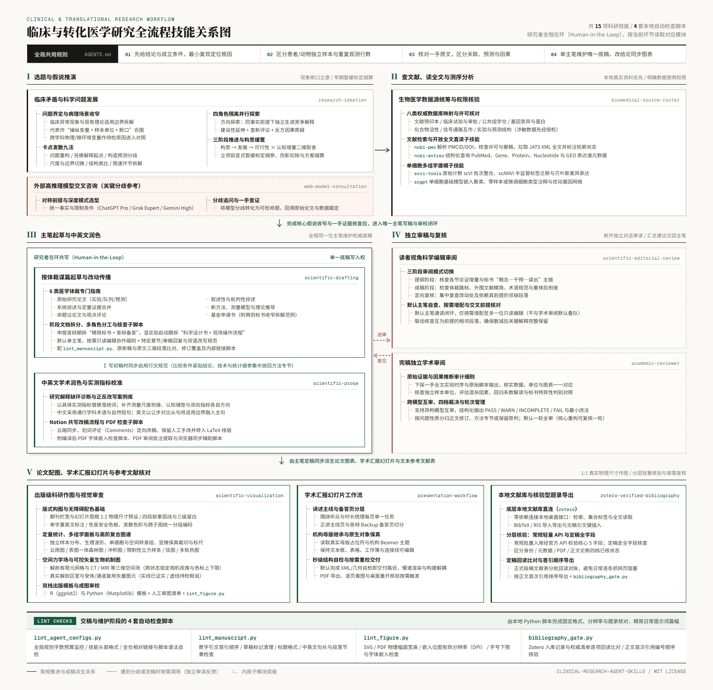

# Clinical Research Agent Skills

[简体中文](README.md) | **English**

Global agent rules, end-to-end methodological skills, and zero-dependency Python static linters for clinical and translational medicine.

This project began around **June 30, 2026, with Anthropic's release of Claude Science**. After community contributors documented its system prompts and modular skill layout, trials on active medical studies led to extracting key quality-control mechanisms—such as running an independent, zero-history `Academic Reviewer` pass at manuscript completion—and adapting them for general-purpose coding agents (Codex, Claude Code, Antigravity, Cursor) and multi-harness ADE workbenches ([T3 Code](https://t3.codes)). Over six months of use across clinical cohorts, disease-mechanism studies, multi-omics, and causal inference projects, the workflow converged into 15 skills spanning hypothesis ideation, full-text verification, single-lead drafting, review triage, scientific figures, slides, and verified citations.

[](docs/assets/skill-architecture.png)

---

## Motivation: Adapting General-Purpose Agents for Research

Flagship coding agents (Claude Code, Codex, Cursor, Antigravity) are built around software engineering and need dedicated configuration for scientific workflows. Meanwhile, specialized scientific clients (such as Claude Science or Open Science) typically ship as standalone, relatively closed applications that rarely match mainstream coding harnesses in customizability, engineering reliability, or update velocity. This repository bridges that gap by equipping mature general-purpose agent clients for clinical and translational research.

While frontier models already bring strong domain knowledge and reasoning, unguided use in multi-month studies consistently exposes three failure modes:

- **Unstable workflow norms across runs.** Without fixed protocols, models approach primary-source checks, study design, or manuscript review from shifting angles each session, producing uneven outputs that are hard to calibrate across iterations.
- **Premature micro-detail fixation and bloated prose.** Models readily fixate on low-level operational minutiae—such as debating specific tool compounds during early hypothesis framing—at the expense of the core narrative, then accumulate layers of inline defensive caveats across review rounds until drafts become dense and unreadable.
- **Subtle intent drift during autonomous planning and exploration.** When analytical impasses, conflicting evidence, or verification hurdles arise in long-horizon tasks, models often quietly relax assumptions, swap endpoints, or pivot to a simpler adjacent proxy question, producing internally coherent work that no longer answers what the investigator set out to study. Mathematicians including Terence Tao, Kevin Buzzard, and Thomas Hales have highlighted an analogous *statement fidelity* risk in Lean formalization—where an LLM tweaks definitions or boundary conditions to rigorously prove a weaker statement than the intended theorem—and Andrej Karpathy's `autoresearch` experiments have similarly exposed specification drift in autonomous loops. Because silent goal shifts are far harder to catch than overt errors, sustained human oversight remains essential.

---

## Positioning Among Open-Source Scientific Agent Repositories

Popular GitHub repositories in this space generally fall into four tracks, each addressing a different layer from this project:

| Category & Representative Repos | Primary Focus | Human-Agent Role & Setup | Quality-Control Emphasis |
| --- | --- | --- | --- |
| **Tool & Database Catalogs**<br>[`K-Dense-AI/scientific-agent-skills`](https://github.com/K-Dense-AI/scientific-agent-skills) (50k+ ★)<br>[`Orchestra-Research/AI-Research-SKILLs`](https://github.com/Orchestra-Research/AI-Research-SKILLs) (14k+ ★)<br>[`google-deepmind/science-skills`](https://github.com/google-deepmind/science-skills) (3k+ ★) | Broad API and package usage guides across 100+ bioinformatics, chemistry, ML, and database tools | Plug-and-play lookup per library or database | Correctness of package calls and data queries |
| **End-to-End / Chat-to-Paper Pipelines**<br>[`SakanaAI/AI-Scientist`](https://github.com/SakanaAI/AI-Scientist) (15k+ ★)<br>[`WUBING2023/PaperSpine`](https://github.com/WUBING2023/PaperSpine) (6k+ ★)<br>[`SamuelSchmidgall/AgentLaboratory`](https://github.com/SamuelSchmidgall/AgentLaboratory) (5k+ ★) | Turning a topic or dataset into executed analyses, figures, and a full draft in a single pipeline | High autonomy or single-command paper delivery | Pipeline throughput and simulated review scores |
| **General Academic Office Suites**<br>[`zLanqing/codex-claude-academic-skills`](https://github.com/zLanqing/codex-claude-academic-skills) (6k+ ★) | Discipline-agnostic reading reports, Word/PPT generation, general prose polishing, and basic plotting | One-click invocation of bundled office/writing skills | Everyday academic document productivity |
| **Standalone Research Desktop Apps**<br>[`aipoch/open-science`](https://github.com/aipoch/open-science) (5k+ ★)<br>[`delibae/claude-prism`](https://github.com/delibae/claude-prism) | Self-contained desktop GUI bundling runtime environments, skills, and custom research packages | Dedicated standalone application | Execution provenance and artifact packaging |
| **Clinical & Translational Methodology**<br>**This repository (`clinical-research-agent-skills`)** | Clinical study-design rigor, stage-appropriate detail control, 6-genre bilingual writing, and 1:1 publication figures | Early **Human-in-the-Loop** guidance and single-author draft ownership inside standard coding clients and multi-vendor ADEs, customized per study | Observational-vs-causal distinction, independent biological replicate checks, cross-model review, and local Python format linters |

Overall, tool-catalog projects address specific software packages and database interfaces, whereas this repository addresses study-design rigor and scholarly argumentation in clinical and translational medicine. Researchers can use catalogs such as `scientific-agent-skills` or `science-skills` for package and database queries, while relying on this repository's methodological guides, cross-model review workflow, and static check scripts when formulating competing hypotheses, separating observational associations from causal claims, defining patient- or animal-level experimental units, and maintaining readability across revision rounds.

---

## Design Evolution & Three Core Sources

1. **Multi-Agent Trials and the Single-Lead-Author Architecture.** Informed by arXiv work on multi-agent research—*Towards an AI Co-Scientist* (`arXiv:2502.18864`), *IdeaScientist* (`arXiv:2610.04074`), and *Agent Laboratory* (`arXiv:2501.04227`)—local head-to-head comparisons between parallel multi-writer section-splitting and a single-writer workflow were conducted on an 80+-citation medical review and recurring revision cases. Splitting tightly coupled manuscripts across parallel writers consistently degraded coherence: shared definitions, notation, denominators, and comparison baselines drifted across sections, mutually dependent premises risked simultaneous deletion from adjacent chapters, and reconciling overlapping subagent critiques added heavy overhead. The workflow therefore enforces a **single-lead-author design**: one lead author holds exclusive write access to the canonical draft, while zero-history, **read-only** subagents inspect frozen snapshots for literature verification or completion review, filtered through a three-tier triage funnel (capped at one full audit plus at most one targeted re-check).
2. **Medical Methodological Guides & Bilingual Prose Calibration.** Study-design and reporting rules draw on multi-journal clinical causal-inference guidance (Lederer et al., *Ann Am Thorac Soc*, 2019), *JAMA* observational causal framing and `Table 2` fallacy safeguards (Dahabreh & Bibbins-Domingo, *JAMA*, 2024; Westreich & Greenland, *Am J Epidemiol*, 2013), `TRIPOD+AI` (Collins et al., *BMJ*, 2024), small-sample distribution and microscopy standards (Weissgerber et al., *PLOS Biol*, 2015; Jambor et al., *PLOS Biol*, 2021), alongside structural writing principles from Mensh & Kording (*PLOS Comput Biol*, 2017), Gopen & Swan (*Am Sci*, 1990), Greenhalgh et al. (*Eur J Clin Invest*, 2018) / `SANRA`, and Bourne & Chalupa (*PLOS Comput Biol*, 2006). Calibrated through bilingual writing across Chinese reviews/grants and English tutorial essays, the rules distinguish genre roadmaps, enforce concise Chinese clauses and exact disciplinary terms, and use English concessive/contrastive subordination (`Although...`, `Whereas...`) with concrete assay readouts (`degranulation`, `cytolysis`) in place of umbrella words (`"killing"`, `"response"`).
3. **Deterministic Static Linting, Tiered Verification & Anti-Stall Boundaries.** Engineering enforcement borrows from SpaceX AI developer Lauren Tan (`@poteto`) in *All Code Is Slop (Except Mine)*, whose team paired strict static linters with automated runtime verification so agents could merge nearly ten thousand pull requests a month unattended (~0.5% revert rate). Yet software engineering and scientific inquiry differ fundamentally in verification: code compilation, type safety, and runtime behavior admit closed-loop machine checks, whereas no linter or test suite can verify whether a clinical question targets a real blind spot, whether controls rule out confounding, or whether an agent has drifted from the original hypothesis. Accordingly, offline Python standard-library scripts here enforce **objective mechanical invariants only**—citation order, leaked draft tags, overloaded sentences, SVG/PDF dimensions, font minimums, raster DPI, Zotero readback parity, and prompt character budgets. To prevent **over-verification stalls** (such as mandatory slow slide rendering/PowerPoint round-trips, endless pixel-tweaking figure loops, per-article HTML scraping during routine Zotero imports, or stacking extra review subagents by default), every delivery skill separates **second-level default structural checks** from **on-demand heavy verification**, decouples slow checks from primary builds, and forbids ending a turn waiting on background checks before delivering output file paths.

---

## Six Stages Across the Research Lifecycle

1. **Ideation & Cross-Model Consultation** — Frame testable competing hypotheses around clinical blind spots or pathophysiological contradictions while deferring low-level calibration math until study design solidifies; optionally cross-examine unresolved primary-source disagreements with an external high-reasoning model.
2. **Primary Literature & Single-Cell Omics** — Check local records first, query NCBI E-Utilities, retrieve open-access PubMed Central JATS XML full text to inspect controls and figure readouts directly, and run standardized `scvi-tools` / `scgpt` single-cell workflows.
3. **Single-Lead Drafting & Bilingual Prose** — Route across six academic genres, split grant defense backups (`Backup`) from bench/animal execution protocols (`SOP`), and keep essential denominators and observation windows attached to claims.
4. **Single-Lead Cohesion Check & Zero-History Academic Review** — Keep reader-flow checks in the lead author's pass by default (spawning at most one read-only editor only on explicit request or heavy restructuring, never stacked with `academic-reviewer` by default), paired with a completion-stage `Academic Reviewer` audit traced back to raw data and primary papers.
5. **Figures, Slides & Tiered Verified Citations** — Produce 1:1 physical-dimension figures in Python/R (one visual check + at most one re-check for standalone publication figures; static gate delivery for slide figures), deliver slides immediately after second-level XML/geometry self-checks (rendering and desktop PowerPoint round-trips on demand), and use tiered Zotero verification (fast structured API checks for routine imports; full field-by-field verification and readback for final submission bibliographies).
6. **Pre-Delivery Deterministic Gates** — Run offline standard-library Python linters across manuscripts, SVG/PDF figures, reference lists, and agent rule budgets alongside visual inspection of rendered outputs.

---

## Operating Principles & Onboarding

- **Human-in-the-Loop and Collaborative Drafting.** Scientific research lacks the closed-loop automated verification available in software development; applying unattended software delivery directly to academic writing tends to produce formally complete drafts with weak argumentation or drifted premises. Accordingly, this project avoids the "one-click autonomous paper generation" model: maintaining **Human-in-the-Loop** oversight is essential for both scientific **quality assurance (QA)** and **academic integrity**. Independent evaluations of end-to-end paper generators—including Beel et al.'s assessment of *The AI Scientist* (`arXiv:2502.14297`) and human-co-pilot comparisons in *Agent Laboratory* (`arXiv:2501.04227`)—confirm that unguided runs fall short of peer-reviewed publication standards. Intervening early at the ideation and outline stages is also far more economical in tokens and revision time than correcting premise drift after a full draft is generated. For long-horizon studies, the workflow defaults to **Notion** prior to LaTeX typesetting: cloud pages and inline **Comments** allow investigators to review outlines, annotate specific claims, or revise prose directly while the agent reads back manual edits before updating. Users of Obsidian, local Markdown + Git, Google Docs, or Overleaf can adapt the same read-before-write workflow.
- **Cross-Model Auditing & ADE Workbench ([T3 Code](https://t3.codes)).** Completion-stage reviews benefit from **cross-family model pairing**—such as a Gemini-authored draft invoking a zero-history GPT reviewer, or vice versa—while single-model setups can run an isolated zero-history read-only session on the same model. Cross-model orchestration is supported by general **ADE (Agentic Development Environment)** workbenches such as **[T3 Code](https://t3.codes)**, which integrates official **first-party harnesses** (OpenAI Codex, Google Antigravity, Claude Code) in a single workspace while preserving first-party stability and update cadence.
- **Chinese-First Core, Deliberate Onboarding & Conflict-Free Rules.** Most methodological and review skills are written in Chinese for Chinese-speaking clinicians and researchers to inspect directly (with API-bound operational tools in English). The repository omits one-click overwrite installers so users selectively adapt modules to their discipline and toolchain. Because frontier models are sensitive to conflicting instructions, each rule category should maintain a single canonical entry point when customized.

---

## Desensitized Showcases & Local Verification

All linters and synthetic showcases use the Python 3.10+ standard library with zero external dependencies (and run on GitHub Actions via `make check`):

- **[Showcase 1: Manuscript Drafting, Review Triage & Static Gate](examples/manuscript-review-triage/README.md)** — Traces a synthetic murine renal ischemia-reperfusion microvascular permeability study from study record and flawed draft through zero-history `Academic Reviewer` output, three-tier triage, revised final draft, and `lint_manuscript.py` verification.
- **[Showcase 2: Nested Experimental Units vs. Pseudoreplication](examples/experimental-unit/README.md)** — Shows how pooling unequal microscopy field counts reverses group-comparison direction relative to animal-level biological replicates.

```sh
# Compare deterministic manuscript gate output before vs. after revision
python3 skills/scientific-drafting/scripts/lint_manuscript.py examples/manuscript-review-triage/draft-before.md
python3 skills/scientific-drafting/scripts/lint_manuscript.py examples/manuscript-review-triage/draft-after.md

# Recompute the animal-level vs. field-level experimental unit example
python3 examples/experimental-unit/analyze.py

# Run repository config linter and all unit test suites
make check
```

- **Component Index**: Full paths for all 15 skills, reference guides, and scripts are indexed in [docs/catalog.md](docs/catalog.md) (overview diagram HTML source: [docs/workflow-overview.html](docs/workflow-overview.html)).
- **License**: Original configurations, skills, linters, diagrams, and synthetic examples are released under the [MIT License](LICENSE); two single-cell skill modules retain upstream `Apache-2.0` declarations as documented in [THIRD_PARTY_NOTICES.md](THIRD_PARTY_NOTICES.md).
