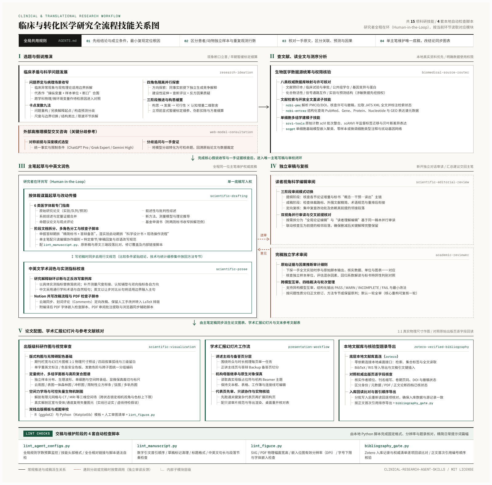

# Clinical Research Agent Skills

**简体中文** | [English](README.en.md)

一套面向临床与转化医学研究的 Agent 全局规则、全流程方法学技能与离线静态检查脚本。

本项目的起点是 **2026 年 6 月 30 日 Anthropic 发布科研工作台 Claude Science**。当时社区整理并公开了其底层系统提示词与模块化技能结构；结合在研医学课题试用后，从中提炼出完稿阶段独立学术审阅（`Academic Reviewer`）等质控机制，将其从专用工作台迁移至通用的 Coding Agent 环境。此后在近半年的临床队列、疾病机制与多组学课题实践中，这套规则在不同 Agent Harness 与多家族前沿模型之间反复验证与精简，逐步定型为覆盖“选题构思—文献与测序分析—多体裁写稿—独立审读—图表幻灯片与书目核验”的工作体系。

[](docs/assets/skill-architecture.png)

---

## 设计初衷：将通用客户端改造为科研环境

主流通用智能体客户端（Claude Code、Codex、Cursor、Antigravity 等）原生围绕软件开发构建，需经专门配置才能适配医学科研流程；而专供科研的垂直客户端（如 Claude Science、Open Science）多为相对封闭的独立软件，在自定义灵活度、工程稳健性与持续更新速度上难以与各厂商主力维护的通用客户端保持同步。本项目的目标即依托成熟通用客户端的工程底座，补齐面向临床与转化医学研究的方法学配置。

当前前沿大模型的领域知识与推理能力已相当成熟，但在真实长线课题中若缺乏流程规范，常出现三类问题：

- **缺乏稳定工作规范，跨次执行一致性不足。** 未设定明确规程时，模型每次处理文献核查、方案设计或成稿审读的切入角度与评判尺度不一，输出质量存在明显波动，难以跨轮次校准。
- **过早聚焦微观细节，多轮修订导致文稿臃肿。** 模型默认倾向关注操作层面的细枝末节，常在构思初期便反复讨论具体工具药物选型等技术细节而冲淡核心科学主线；进入多轮审阅与修改后，又容易将历次顾虑逐层叠加为正文中的防御性限定语，显著降低文稿可读性。
- **自主规划与遇阻调整中发生隐蔽的意图偏离。** 在长链路方案执行与自主探索中，模型遇到推导受阻、证据冲突或验证困难时，有时会悄然放宽前提条件、替换结局指标，转向更易求解的邻近弱化问题，使最终结果表面逻辑自洽却偏离了研究者的初始意图。陶哲轩（Terence Tao）、Kevin Buzzard 与 Thomas Hales 等数学家在形式化证明（Lean）协作中多次指出类似的“命题保真度（statement fidelity）”风险——模型受阻时可能微调定义或边界条件，严密证出一个变形后的简化命题而非原命题；Andrej Karpathy 在自主实验循环（`autoresearch`）实践中也观察到长程探索绕开核心难点、偏离初始目标的规约漂移现象。这类偏离远比显性错误隐蔽，需要研究者在关键节点持续审核把关。

---

## 与同类开源项目的定位对比

GitHub 上围绕科研 Agent 与学术 Skills 已形成几类代表性高 Star 项目，各自侧重的层面与本仓库有所不同：

| 项目类型与代表仓库 | 核心侧重 | 人机分工与接入方式 | 质量控制重心 |
| --- | --- | --- | --- |
| **工具与数据库目录型**<br>[`K-Dense-AI/scientific-agent-skills`](https://github.com/K-Dense-AI/scientific-agent-skills)（50k+ ★）<br>[`Orchestra-Research/AI-Research-SKILLs`](https://github.com/Orchestra-Research/AI-Research-SKILLs)（14k+ ★）<br>[`google-deepmind/science-skills`](https://github.com/google-deepmind/science-skills)（3k+ ★） | 广泛覆盖上百个生信、化学、机器学习软件包与公共数据库 API 的调用指南 | 按工具或数据库名称即插即用 | 接口参数与代码运行正确性 |
| **端到端与单指令成文型**<br>[`SakanaAI/AI-Scientist`](https://github.com/SakanaAI/AI-Scientist)（15k+ ★）<br>[`WUBING2023/PaperSpine`](https://github.com/WUBING2023/PaperSpine)（6k+ ★）<br>[`SamuelSchmidgall/AgentLaboratory`](https://github.com/SamuelSchmidgall/AgentLaboratory)（5k+ ★） | 从研究问题或数据出发，自动串联分析、制图并一次性生成完整论文草稿 | 强调端到端自动化或单条指令直接生成文稿 | 流程贯通效率与模拟同行评审评分 |
| **通用中文学术办公型**<br>[`zLanqing/codex-claude-academic-skills`](https://github.com/zLanqing/codex-claude-academic-skills)（6k+ ★） | 面向跨学科通用的文献阅读报告、Word / PPT 文档生成、常规润色与基础绘图 | 三个通用技能包在客户端内一键调用 | 日常学术文档效率与版式规整度 |
| **独立科研桌面客户端**<br>[`aipoch/open-science`](https://github.com/aipoch/open-science)（5k+ ★）<br>[`delibae/claude-prism`](https://github.com/delibae/claude-prism) | 自带独立桌面界面、内置运行环境与专属打包格式的一体化科研工作台 | 下载独立客户端并在软件自有框架内运行 | 软件内执行留痕与结果复现打包 |
| **临床与转化医学方法学型**<br>**本仓库（`clinical-research-agent-skills`）** | 临床与转化医学的研究设计规范、阶段细节控制、六类体裁双语写作与 1:1 出版级图表 | **Human-in-the-Loop** 全程主导、唯一主笔维护底稿；在常用客户端与多端 ADE 中按课题选读定制 | 关联与因果区分、独立样本单位核实、跨模型独立审阅及本地 Python 静态检查脚本 |

总体而言，工具目录型项目主要解决特定软件包与数据库接口的调用问题，本仓库则侧重于临床与转化医学的研究设计与学术论证规范。涉及具体生物信息学工具或公共数据库检索时，本仓库可与 `scientific-agent-skills`、`science-skills` 等工具库配合使用。在构建竞争假说、区分观察性关联与因果推断、界定患者或动物层级的独立样本单位，以及控制多轮修订中的文稿篇幅与可读性时，则由本仓库的方法学规范、跨模型审阅流程与静态检查脚本提供支撑。

---

## 演进脉络与三个主要来源

### 1. 多智能体协作与“唯一主笔”对照实践

在探索长篇综述、命题议论文与基金申请书的协作方式时，本项目参考了 arXiv 上的多智能体科研代表工作，包括以“生成—评议—演进”辅助假说推演的 *Towards an AI Co-Scientist*（`arXiv:2502.18864`）、按角色编排缺口识别与方案撰写的 *IdeaScientist*（`arXiv:2610.04074`），以及模拟团队分工与同行评审循环的 *Agent Laboratory*（`arXiv:2501.04227`）。

针对“多 Agent 按章节并行起草再合并成稿”的常见做法，本地在包含 80 余篇引文的医学长篇综述及多组修订案例上开展了单主笔与多角色并行的同稿对照测试。结果显示，结构紧密耦合的医学论文与申请书并不适合分章并行起草：前后章节高度共享概念定义、符号、样本分母与比较前提，多路改写极易引起跨节术语漂移，甚至导致两处互为前提的论述在各自局部视角下被同时删去；多角色并行还会产生大量重复或脱离上下文的修改意见，显著增加统稿负担。

据此，整套流程收敛为**唯一主笔制**：由单一主笔独占写入权限、维护唯一权威底稿，统一处理概念定义与跨节衔接；仅在全文重构需核对大批量一手文献、或完稿审阅超出单次会话注意力上限时，基于固定底稿快照派发无历史记录的**只读**子会话并行核查。审阅意见由主笔按三类分流处置：涉及核心结论或对照设计的实质缺陷直接改入正文，常规质控与统计参数归入方法节或技术难点表，超出当前研究阶段范围的延伸建议记录取舍依据；默认一轮全面审阅收束，核心设计重构时仅针对变动部分复核一轮。

### 2. 权威医学期刊方法学指南与双语写作校准

研究设计与篇章组织吸收了多篇权威医学与科学期刊的方法学综述：

- **研究设计与图表统计规范**：涵盖多本临床专科期刊主编联合发布的观察性因果推断指南（Lederer 等，*Annals of the American Thoracic Society*, 2019，区分描述、预测与因果推断任务并依先验或有向无环图选定混杂集）、*JAMA* 观察性因果推断框架与 `Table 2` 谬误警示（Dahabreh & Bibbins-Domingo, *JAMA*, 2024；Westreich & Greenland, *Am J Epidemiol*, 2013）、临床预测模型报告准则 `TRIPOD+AI`（Collins 等，*BMJ*, 2024），以及小样本个体分布与生物显微图像呈现规范（Weissgerber 等，*PLOS Biology*, 2015；Jambor 等，*PLOS Biology*, 2021）。
- **谋篇结构与课题设计原则**：融合 Mensh & Kording（*PLOS Computational Biology*, 2017）的“背景—内容—结论（Context–Content–Conclusion）”段落闭合结构、Gopen & Swan（*American Scientist*, 1990）“句首承接已知话题、句末落位新发现”的信息流原则、Greenhalgh 等（*Eur J Clin Invest*, 2018）与 `SANRA` 量表的叙述性综述规范，以及 Bourne & Chalupa（*PLOS Computational Biology*, 2006）基金申请书子目标“假说统一、风险解耦”的架构原则。

结合中文综述、基金申请书与英文命题议论文（Tutorial Essay）的双语写作实践，规则进一步细分了体裁结构与双语句法。期刊综述与申请书集中篇幅呈现研究设计与结果的实质比较，省去空泛的阶段小结；命题议论文与期刊观点评论（Perspective / Opinion）则在引言末句明确中心论断，并在各主体节末尾保留扣题总结。中文控制单句信息负荷、核准跨学科规范译名（如区分生物化学“底物”与生物材料“基底”的 `substrate`）；英文通过让步与对比从句（`Although...`、`Whereas...`）内嵌适用条件，并以脱颗粒（`degranulation`）、细胞裂解（`cytolysis`）等具体实测指标替代 `"killing"`、`"response"` 等笼统表述。

### 3. 静态检查优先与科研验证的边界

工程实现借鉴了 SpaceX AI 开发者 Lauren Tan（`@poteto`）在 *All Code Is Slop (Except Mine)* 演讲中提出的原则：**将确定性规范转化为静态 Lint 规则。** 在软件工程场景中，其团队依托严密的静态检查、架构约束与自动化运行时验证（Verification），使智能体在夜间无人值守条件下单月安全合并近万个代码 PR，并将回退率维持在约 0.5%。

然而，软件工程与科学研究在验证机制上存在本质区别。代码能否编译、类型是否安全、接口行为是否符合预期，均可在明确规约下由机器闭环判定；而在医学科研中，没有任何静态脚本或单元测试能够判断“科学问题是否针对真实的临床判别盲区”或“对照设计是否有效排除了混杂偏倚”，也无法识别模型遇阻时是否已偏离原始研究意图。

因此，本仓库仅将**客观机械约束**交由本地 Python 脚本自动核验——包括文稿数字引文顺序、残留草稿标记、超长句定位、矢量图物理尺寸与内嵌位图有效分辨率（DPI）、字号下限、Zotero 题录回读核对及全局提示词字符预算（成图排版另配目视检查）。固定格式校验由脚本承担后，日常提示词得以保持精简，而样本独立性、对照逻辑与推论边界等科学判断始终由研究者直接掌控。

---

## 覆盖科研全流程的六个环节

日常会话仅加载一页全局共用规则，确立“结论与成立条件先行、最小复现定位根因、核对一手原文区分关联与因果、单主笔维护唯一底稿”四项准则，随课题推进按阶段启用对应技能模块：

**1. 选题与假说推演。** 从临床判别盲区、反常实验现象或既有理论适用边界切入，构建可由实验结果互相区分的竞争假说。立项初期聚焦核心因果链与决定性判别对照，暂缓仪器标定、伪影扣除与方差细算。核查现有数据与文献后若仍存在影响路线选择的关键分歧，可将对称的事实前提与限制条件交由外部高推理模型交叉质询，再回到原始文献核实。

**2. 查文献、读全文与测序分析。** 优先核查本地既有记录，再检索 PubMed、基因与表达谱等公共数据库。精读代表性论文时优先获取 PubMed Central 开放获取 JATS XML 全文，直接核对原文样本流转、对照组设置目的与具体图注读数，并如实记录检索状态。多组学方向配套单细胞 RNA-seq 批次整合、注释迁移与差异表达分析规程。

**3. 主笔起草、体裁区分与中英文润色。** 按原始研究、叙述性综述、系统综述、方法学论文、基金申请书、命题议论文六类体裁组织文稿。基金与开题计划以临床判别或病理生理规律立意，文档随研发阶段分流维护——申报答辩期拆分为“精简主标书 + 答辩备答库”，湿实验启动期拆分为“研究设计书 + 现场操作规程”。决定结论成立的对照组、样本分母与观察时间窗紧贴结论写明，仪器标定与多重检验参数集中归入方法专节。

**4. 独立审稿与复核。** 包含两项无历史上下文的只读审阅：文稿大幅重排或压缩后，从目标读者视角检查概念铺垫顺序、指代衔接与前提完整性；正式论文、申请书或研究报告完稿时启动独立学术审阅，从核心结论逆向核查原始数据、独立实验单位与主要混杂因素。

**5. 论文作图、汇报幻灯片与参考文献核对。** 科研制图按期刊栏宽或幻灯片内容框 1:1 物理尺寸由代码或可控矢量绘制，涵盖统计分布、多组学面板、三维空间场与机制示意图。幻灯片工作流规范汇报叙事、机构母版继承与原生对象可编辑性；文献管理连接本地 Zotero 桌面端，对照出版页逐字段核实并回读校验，按正文首次引用顺序导出参考文献表。

**6. 交稿前的脚本自动检查。** 文稿、矢量图件（SVG / PDF）、参考文献表与规则配置均配有零第三方依赖的离线检查脚本，自动校验引文顺序、物理尺寸、位图分辨率、字号下限与题录一致性，并与导出成图的目视检查配合使用。

---

## 核心工作原则与接入说明

### 1. Human-in-the-Loop 与协同写作平台

科学研究不具备纯软件开发中由机器闭环判定的自动验证条件，直接套用软件工程的无人值守交付模式，容易产生格式完整但论证薄弱或偏离研究初衷的稿件。因此，本项目不采用“一键全自动生成论文”的设计路线：维持 **Human-in-the-Loop**（研究者全程在环主导），既是保障研究质量（QA）的必要条件，也是研究者对课题立意、数据真实性与推论边界承担责任的学术诚信要求。

多项针对全自动论文生成系统的实证研究印证了这一判断：对 *The AI Scientist* 的独立评估（Beel 等，`arXiv:2502.14297`）显示，无人值守生成的稿件普遍存在文献检索浅表、实验设计缺漏与结论失真等问题，难以达到同行评审期刊的发表要求；*Agent Laboratory*（`arXiv:2501.04227`）的对照实验亦表明，引入人类研究者阶段性参与显著优于全自动模式。在执行效率上，**于立项构思与提纲阶段及早介入也更为经济**：若待全文自动生成后再修正前提偏差，往往需要连带调整文献筛选、统计口径、图表与正文结构，耗费的 Token 与返工时间远高于早期校准。

为此，长线课题默认采用 **Notion** 整理文献笔记、迭代研究方案与修订初稿（定稿后转入 LaTeX 排版）。云端页面便于随时审阅早期提纲，原生的划词评论（Comments）功能支持研究者直接选中具体论断或表格添加批注，或直接修改正文措辞，再由 Agent 读取人工修改与批注记录后定向更新，形成“写前先读、保留人工修改、按批注修订并回读确认”的协作流程。日常使用 **Obsidian、Logseq、本地 Markdown + Git、Google Docs 或 Overleaf** 的研究者，可沿用同一协同逻辑，由 Agent 将读写流程适配至对应软件。

### 2. 跨模型交叉审计与 ADE 工作台

完稿审阅环节推荐采用不同模型家族之间的**交叉审计**：例如由 Gemini 主笔完成的方案或初稿调用无历史上下文的 GPT 模型执行独立审阅，或由 GPT 主笔反向调用 Gemini 模型审阅。不同家族前沿模型在宏观结构组织、数理推导与细节核查上各有侧重，异构互审更容易发现单一模型的潜在盲区；若仅配置单一模型，在全新无历史只读会话中完成独立自审同样可行。

实现跨模型调用与协同可借助通用的 **ADE（Agentic Development Environment）** 工作台，较为推荐 **[T3 Code](https://t3.codes)**。区别于另建封闭执行层的第三方客户端，该平台将 OpenAI Codex、Google Antigravity、Claude Code 等各厂商的**第一方原生 Harness** 整合于同一工作台内，既保留第一方客户端的工程稳定性与更新节奏，又支持跨家族模型的自动委派审阅。

### 3. 语言定位、接入方式与指令一致性

- **中文方法学主干**：仓库现阶段主要面向中文科研读者。除强依赖软件接口与命令行规范的操作模块保留英文外，涉及科学判断、谋篇结构与审阅分流的技能均以中文撰写，便于研究者逐条审视内在逻辑（精炼英文导览见 [English Overview](README.en.md)）。
- **保留接入思考门槛**：仓库未设一键覆盖安装脚本或即拷即用的自动注入指令。严谨的科研工作流需要使用者结合自身学科方向与工具链主动取舍，方能发挥自定义配置的价值。
- **保持指令链零冲突**：前沿模型对指令表述高度敏感。组合或修改多套规则时，应清理彼此抵触的要求（如交付位置、模型调用范围或句法规范不一致），每类规则仅保留单一权威入口，避免模型执行摇摆或文风割裂。

本配置适用于 Codex、Claude Code、Antigravity、Cursor 等客户端及 T3 Code 工作台，推荐两种接入路径：

- **选读模块后与 Agent 讨论合入（推荐）**：将仓库克隆至本地目录，结合下方的直观样本审读所需模块，与自己的 Agent 讨论后筛选契合自身研究方向的规则与检查脚本融入现有配置。
- **独立空白环境试运行**：单独准备干净的 Agent 配置目录，先使用仓内脱敏合成样本或小型独立课题完整运行各环节流程，熟悉协作方式后再按需增删。

---

## 脱敏直观样本与本地自检

仓库附带两组完全离线、基于脱敏合成材料的对照样本及基于 Python 3.10+ 标准库的静态检查脚本：

- **[直观样本一：文稿起草、独立审阅三级分流与静态门禁闭环](examples/manuscript-review-triage/README.md)** — 以小鼠急性肾缺血再灌注微血管内皮屏障渗漏实验为例，呈现从[研究记录](examples/manuscript-review-triage/study-record.md)、含越界表述与格式错误的[待修初稿](examples/manuscript-review-triage/draft-before.md)、[独立学术审阅回报与三级分流台账](examples/manuscript-review-triage/review-and-triage.md)到[主笔修订定稿](examples/manuscript-review-triage/draft-after.md)并通过脚本核验的全过程。
- **[直观样本二：嵌套实验单位与伪重复纠偏复算](examples/experimental-unit/README.md)** — 以每只动物采集不等量显微镜视野的合成数据为例，演示按独立实验动物聚合统计量、避免将视野行数直接作为样本量而导致组间结论反转的分析过程。

可在仓库根目录直接运行以下命令验证（推送或提交 Pull Request 时由 GitHub Actions 自动执行同一检查）：

```sh
# 对比“待修初稿”与“主笔修订定稿”在文稿静态检查脚本下的检查结果
python3 skills/scientific-drafting/scripts/lint_manuscript.py examples/manuscript-review-triage/draft-before.md
python3 skills/scientific-drafting/scripts/lint_manuscript.py examples/manuscript-review-triage/draft-after.md

# 复算“60 行视野读数 vs 独立实验动物样本数”合成案例
python3 examples/experimental-unit/analyze.py

# 运行全仓配置检查与全部单元测试
make check
```

- **目录索引**：全仓 15 个技能模块、参考文档与检查脚本路径汇总见[附录：仓库组件索引](docs/catalog.md)（架构图网页源码见[可视化概览](docs/workflow-overview.html)）。
- **开源协议**：原创指令、技能文档、检查脚本、关系图与合成样本采用 [MIT License](LICENSE) 开源；两个单细胞分析技能保留上游 Apache-2.0 声明，详见 [第三方协议说明](THIRD_PARTY_NOTICES.md)。未发表课题数据、个人文献库快照与机构网络配置请保留在本地环境。
